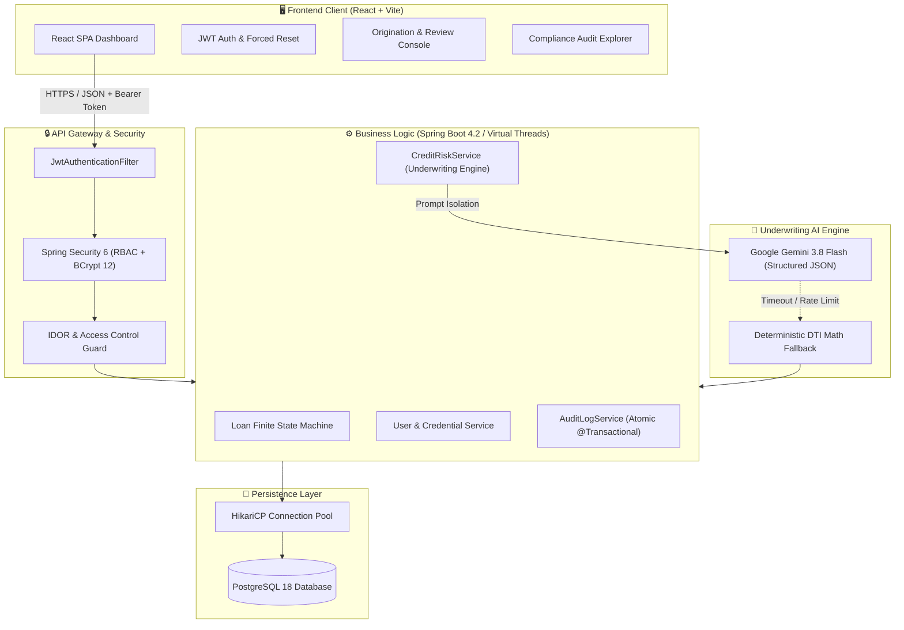
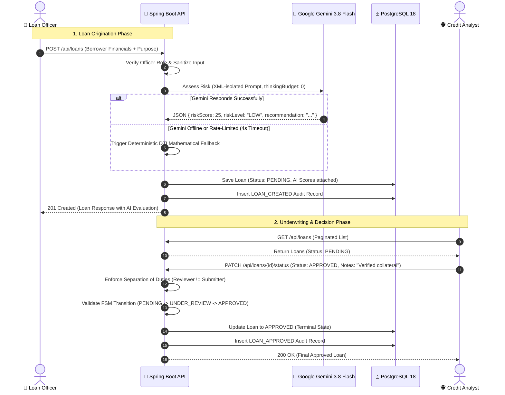
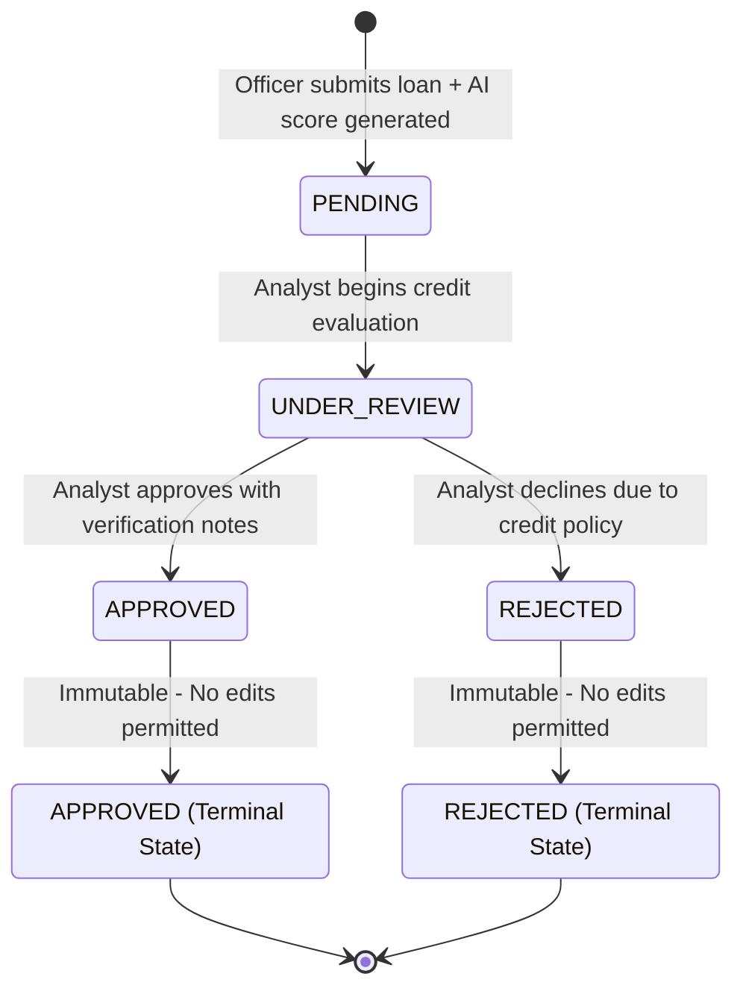
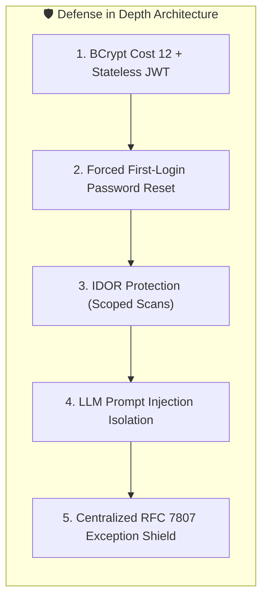

# 🛡️ FinGuard AI — Enterprise Loan Origination & Automated Credit Risk Platform

[]()
[]()
[]()
[]()
[]()
[]()
[]()

**FinGuard AI** is a production-oriented, full-stack financial platform designed for commercial loan origination, compliance governance, and AI-accelerated credit risk underwriting. Built with **Spring Boot 4.2 (Java 21 Virtual Threads)**, **PostgreSQL 18**, and a modern **React frontend**, it bridges institutional banking controls with next-generation LLM intelligence.

---

## 🏗️ High-Level System Architecture

FinGuard AI decouples the client presentation layer, stateless backend security gateway, business domain state machine, and asynchronous external LLM evaluation:



---

## 🔄 End-to-End Workflow & Separation of Duties

To prevent insider fraud and regulatory non-compliance, FinGuard enforces the **Four-Eyes Principle**:
1. **Loan Officers** can onboard borrowers and submit applications.
2. Applications are automatically scored in real time by **Google Gemini AI**.
3. **Credit Analysts** independently review the application, score, and borrower financials.
4. An officer **cannot review or approve loans they submitted**.



---

## 🚦 Strict Finite State Machine (FSM)

FinGuard locks loan applications to an immutable transition model:



* **No Self-Approvals**: The submitter's User ID cannot equal the reviewer's User ID.
* **Terminal Immutability**: Once `APPROVED` or `REJECTED`, applications cannot be transitioned, edited, or re-evaluated.

---

## 🛡️ Enterprise Security & Hardening Features



| Security Layer | Implementation Mechanism | Threat Mitigated |
|---|---|---|
| **Stateless Authentication** | JJWT (0.12.6) + `JwtAuthenticationFilter` | Session hijacking, CSRF |
| **Credential Hygiene** | `mustChangePassword=true` flag enforced on login | Default credential exploitation |
| **Separation of Duties** | `LoanService.reviewLoan()` identity validator | Internal loan fraud / collusion |
| **IDOR Protection** | `LoanService.getLoanById()` submitter ownership validation | Horizontal privilege escalation |
| **Prompt Injection Defense** | `systemInstruction` + XML boundary `<purpose>...</purpose>` | Adversarial prompt hijacking |
| **Information Leak Shield** | `GlobalExceptionHandler` returning `ApiErrorResponse` | Database schema / stack trace leaks |
| **DoS Prevention** | Spring Data `Pageable` on all list endpoints | Database memory starvation |

---

## 💻 Tech Stack

### Frontend (React SPA)
* **Framework**: React 19, TypeScript / JavaScript
* **Build Tool**: Vite (Instant HMR, optimized production chunks)
* **UI & Styling**: Tailwind CSS, Lucide React Icons
* **Data Fetching**: TanStack Query (React Query) / Axios
* **Routing**: React Router v7

### Backend (Spring Boot Core)
* **Runtime**: Java 21 LTS with **Project Loom Virtual Threads** (`spring.threads.virtual.enabled=true`)
* **Framework**: Spring Boot 4.2.0
* **Security**: Spring Security 6 (Stateless JWT, Role-Based Access Control)
* **ORM & Data**: Spring Data JPA, Hibernate 7, HikariCP (`open-in-view=false`)
* **Database**: PostgreSQL 18
* **AI Engine**: Google Gemini API (`gemini-3.8-flash` / `gemini-2.5-flash` via Spring `RestClient`)
* **Documentation**: Springdoc OpenAPI 3.2 / Swagger UI
* **Quality Assurance**: JUnit 5, Mockito, AssertJ, Spring Boot Test (14/14 automated tests passing)

---

## ⚡ Quick Start

### 1. Prerequisites
* **Java 21 JDK** installed
* **Node.js 20+** & npm installed
* **PostgreSQL 18** (or Docker)
* **Google Gemini API Key** (from [Google AI Studio](https://aistudio.google.com/))

---

### 2. Backend Setup

```bash
cd finguard-api

# Create local environment config from template
cp .env.example .env
```

Configure your `.env` file:
```env
DB_HOST=localhost
DB_NAME=finguard
DB_USER=postgres
DB_PASSWORD=your_db_password
JWT_SECRET=404E635266556A586E3272357538782F413F4428472B4B6250645367566B5970
JWT_EXPIRATION_MS=86400000
GEMINI_API_KEY=your_actual_gemini_api_key
GEMINI_MODEL=gemini-3.8-flash
CORS_ALLOWED_ORIGINS=http://localhost:5173,http://localhost:4200
MAIL_HOST=smtp.your-provider.com
MAIL_PORT=587
MAIL_USERNAME=your_smtp_username
MAIL_PASSWORD=your_smtp_password
MAIL_SMTP_AUTH=true
MAIL_SMTP_STARTTLS=true
```

SMTP credentials are required for admin email campaigns. Staff can view active borrower contact details; administrators can send a campaign to selected borrowers. Payment reminders include each borrower's total due/overdue installment amount and earliest due date.

Run tests and start the API:
```bash
# Run unit & integration test suite (14 tests)
./mvnw clean test

# Start the Spring Boot application
./mvnw spring-boot:run
```

* **API URL**: `http://localhost:8080`
* **Swagger UI (Interactive Docs & JWT Testing)**: `http://localhost:8080/swagger-ui/index.html`
* **Default Super Admin**: `admin@finguard.com` / `Admin@123`

---

### 3. Frontend Setup (React SPA)

```bash
cd finguard-frontend

# Install dependencies
npm install

# Start Vite development server
npm run dev
```

* **Frontend Dashboard**: `http://localhost:5173`
* Communicates directly with backend at `http://localhost:8080` (CORS pre-configured).

---

### 4. Zero-Config Docker Deployment (Backend + PostgreSQL)

```bash
cd finguard-api
docker compose up --build -d
```

Spins up both PostgreSQL 18 and the multi-stage, non-root FinGuard API container.

---

## 📋 Complete API Reference

### 🔐 Authentication (`/api/auth`)
| Method | Endpoint | Required Role | Description |
|---|---|---|---|
| `POST` | `/api/auth/login` | Public | Authenticates credentials and returns a signed JWT token. |
| `POST` | `/api/auth/change-password` | Authenticated | Mandatory first-login password reset (`mustChangePassword: true`). |

### 👥 Staff User Management (`/api/admin/users`)
| Method | Endpoint | Required Role | Description |
|---|---|---|---|
| `POST` | `/api/admin/users` | `ADMIN` | Onboards new `LOAN_OFFICER` or `CREDIT_ANALYST`. |
| `GET` | `/api/admin/users` | `ADMIN` | Returns paginated list of staff members. |
| `PATCH` | `/api/admin/users/{id}/status` | `ADMIN` | Activates or suspends staff account (self-suspension guarded). |

### 📝 Loan Applications (`/api/loans`)
| Method | Endpoint | Required Role | Description |
|---|---|---|---|
| `POST` | `/api/loans` | `LOAN_OFFICER` | Creates loan, triggers real-time Gemini AI scoring, and logs audit. |
| `GET` | `/api/loans` | `LOAN_OFFICER`, `CREDIT_ANALYST`, `ADMIN` | Paginated loans (officers restricted to their submissions via IDOR guard). |
| `GET` | `/api/loans/{id}` | `LOAN_OFFICER`, `CREDIT_ANALYST`, `ADMIN` | Fetches a loan with ownership validation. |
| `PATCH` | `/api/loans/{id}/status` | `CREDIT_ANALYST` | Reviews and sets terminal state (`APPROVED` / `REJECTED`). |

### 📜 Compliance & Audit Trail (`/api/audit-logs`)
| Method | Endpoint | Required Role | Description |
|---|---|---|---|
| `GET` | `/api/audit-logs` | `ADMIN`, `AUDITOR` | Paginated immutable audit trail across all sensitive actions. |
| `GET` | `/api/audit-logs/entity/{type}/{id}` | `ADMIN`, `AUDITOR` | Complete change history for a specific loan or user. |

---

## 🧪 Comprehensive Automated Test Coverage

FinGuard AI maintains an end-to-end test suite verified on every push by **GitHub Actions**:

```text
[INFO] Results:
[INFO] Tests run: 14, Failures: 0, Errors: 0, Skipped: 0
[INFO] ------------------------------------------------------------------------
[INFO] BUILD SUCCESS
```

* **`LoanServiceTest` (6 tests)**:
  * Real-time Gemini risk score integration & audit record generation.
  * Separation of duties enforcement (`IllegalStateException` on self-approval).
  * Terminal state immutability (cannot modify approved/rejected loans).
  * IDOR protection (`AccessDeniedException` when officer queries peer loans).
  * Global analyst query permissions.
* **`JwtServiceTest` (3 tests)**:
  * Token creation, claims extraction, signature verification, and expired token rejection.
* **`CreditRiskServiceTest` (2 tests)**:
  * Structured Gemini JSON candidate parsing.
  * Deterministic DTI fallback calculation on API downtime or rate-limiting.
* **`AuditLogServiceTest` (2 tests)**:
  * Atomic audit logging and paginated history filtering.
* **`FinguardApiApplicationTests` (1 test)**:
  * Full Spring Boot context startup & PostgreSQL connection health.

---

## 🤝 Contributing & License
Proprietary platform built for enterprise lending environments. Pull requests and feature suggestions are welcome.
